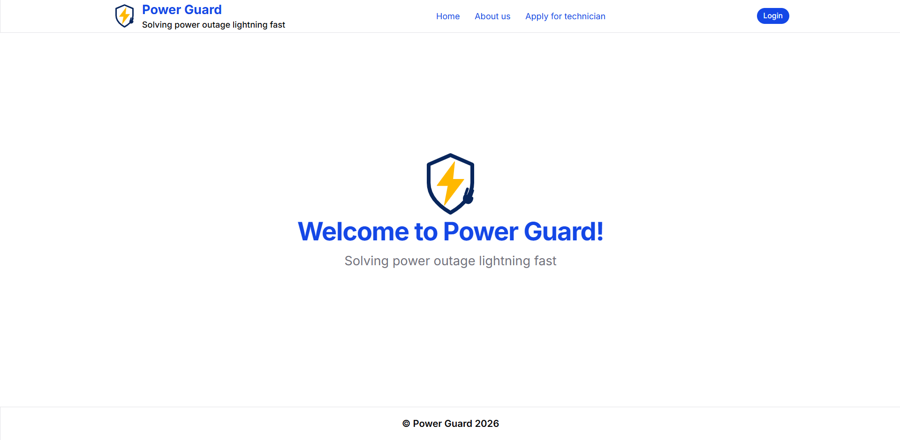
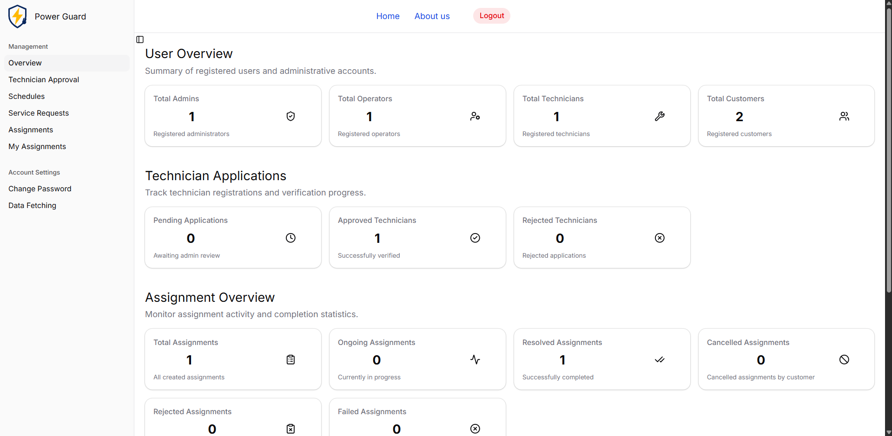
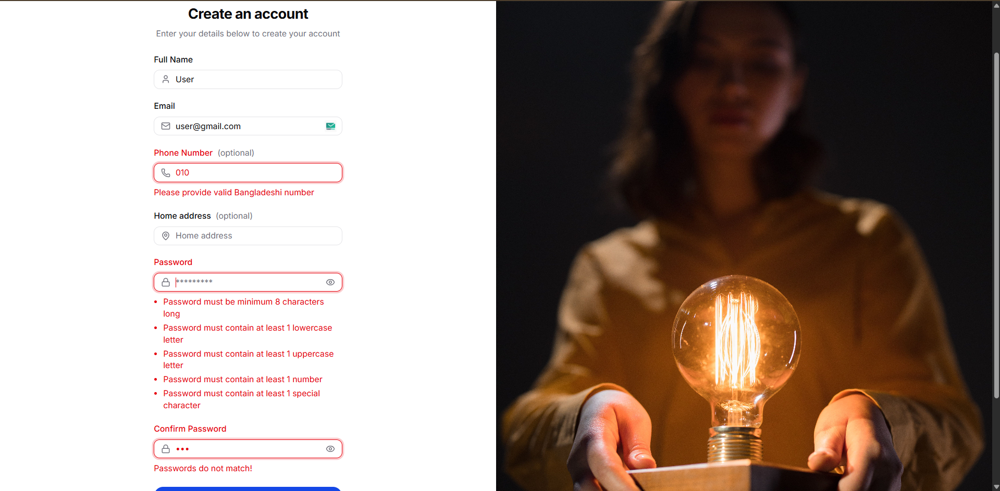
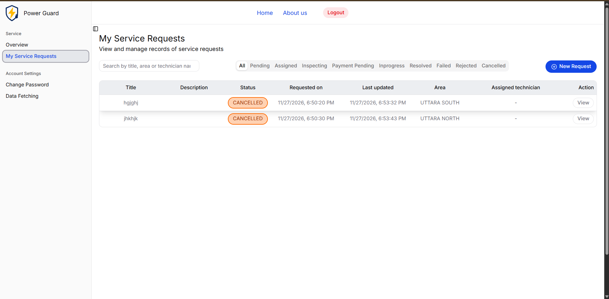
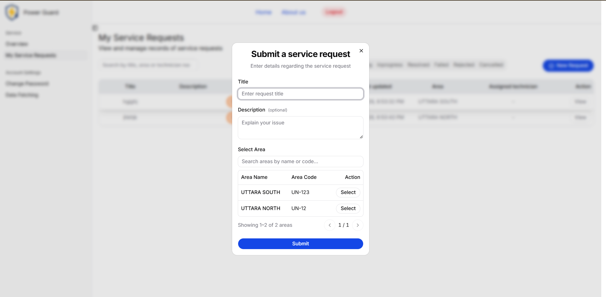

# ⚡ Power Guard – Frontend

<div align="center">

[](https://github.com/AlNahianFatin/PowerGuard_Frontend/stargazers)
[](https://github.com/AlNahianFatin/PowerGuard_Frontend/network)
[](https://github.com/AlNahianFatin/PowerGuard_Frontend/issues)

**A modern, responsive web application for managing scheduled load shedding, reporting power outages, coordinating technicians, and monitoring service restoration through role-based dashboards.**

[Live Demo](https://github.com/AlNahianFatin/Al-Nahian-Fatin-Portfolio-Dashboard) 
[Backend Repository](https://github.com/AlNahianFatin/PowerGuard_Backend)

</div>

## 📖 Overview

Power Guard is a Load Shedding & Power Outage Management System designed to improve communication and coordination between electricity consumers, field technicians, power operators, and administrators.

This repository contains the frontend application. It provides the user interface through which customers can access power-related services, submit and follow up on service requests, and interact with the platform. It also provides role-specific interfaces for technicians, operators, and administrators to manage assigned work, outage schedules, and operational activities.

The application is built with **Next.js, React, TypeScript, and Tailwind CSS**. It uses TanStack Query for server-state management, TanStack Form and Zod for form handling and validation, and `ofetch` for communicating with the backend REST API.

The frontend communicates with the dedicated [Power Guard Backend](https://github.com/AlNahianFatin/PowerGuard_Backend), which handles authentication, business logic, database operations, and integrations with external services.

## ✨ Features

- **Role-Based User Experience**: Provides separate application workflows for customers, technicians, operators, and administrators.
- **Authentication**: Supports credential-based sign-in and Google authentication integration.
- **Customer Services**: Provides customer-facing interfaces for accessing power services and submitting service requests.
- **Service Request Management**: Allows users to submit and monitor requests related to power interruptions and restoration.
- **Technician Workspace**: Provides interfaces for technician applications, profile information, assigned work, and service request updates.
- **Technician Application Workflow**: Supports collecting technician information and submitting relevant documents for review.
- **Outage Schedule Management**: Provides operational interfaces for viewing and managing planned load-shedding schedules.
- **Operational Dashboards**: Displays role-specific information and management views for platform operations.
- **Form Management**: Uses TanStack Form to manage complex forms and Zod to validate user input.
- **Server-State Management**: Uses TanStack Query to fetch, cache, and synchronize remote application data.
- **API Communication**: Uses `ofetch` to communicate with the backend API.
- **Reusable UI Components**: Uses Base UI and shadcn/ui component conventions to build consistent interfaces.
- **Date & Calendar Utilities**: Uses date-fns and React Day Picker for date-related interactions.
- **Responsive Interface**: Uses Tailwind CSS for responsive layouts and styling.
- **Google OAuth Integration**: Uses Google OAuth components for the frontend authentication flow.
- **Type-Safe Development**: Uses TypeScript and Zod to improve application reliability and maintainability.

## 🖥️ Screenshots







## 🛠️ Tech Stack

### **Frontend Framework & Core**


### **Styling & UI Components**


### **State Management & Data Fetching**


### **Validation & Utilities**


### **Development Tools**


## 🚀 Quick Start

Follow these steps to run the frontend application locally.

### Prerequisites

- Node.js (LTS version recommended)
- Bun 1.4.0 
- Git
- A running instance of the [Power Guard Backend](https://github.com/AlNahianFatin/PowerGuard_Backend)
- Google OAuth client ID if you want to use Google authentication locally

### Installation

1. **Clone the repository**

   ```bash
   git clone https://github.com/AlNahianFatin/PowerGuard_Frontend.git
   cd PowerGuard_Frontend
   ```

2. **Install dependencies**

   The repository declares Bun as its package manager:

   ```bash
   bun install
   ```

   You can install Bun by following the instructions in the [official Bun documentation](https://bun.sh/docs/installation).

3. **Environment setup**

   Create a `.env.local` file in the project root:

   ```bash
   cp .env.example .env.local
   ```

   Configure the following environment variables:

   | Variable | Description | Example | Required |
   | :--- | :--- | :--- | :---: |
   | `NEXT_PUBLIC_API_BASE_URL` | Base URL of the Power Guard backend API. | `http://localhost:5000/api/v1` | Yes |
   | `NEXT_PUBLIC_GOOGLE_CLIENT_ID` | Google OAuth client ID used for Google authentication. | `your-google-client-id` | For Google authentication |

   Make sure the API base URL matches the backend server configuration. Since these variables use the `NEXT_PUBLIC_` prefix, their values are exposed to the browser. Do not put private API keys, passwords, or server-side secrets in these variables.

4. **Start the development server**

   ```bash
   bun run dev
   ```

5. **Open your browser**

   Visit:

   ```text
   http://localhost:3000
   ```

   Ensure the backend is running and accessible through `NEXT_PUBLIC_API_BASE_URL` for application features that require API communication.

## 📁 Project Structure

The repository keeps the application source code under `src/` and static assets under `public/`.

```text
PowerGuard_Frontend/
├── public/                 # Static assets such as images, icons, and other public files
├── src/                    # Next.js application source code
├── .env.example            # Environment variable template
├── .gitignore              # Git ignored files
├── AGENTS.md               # Agent/development guidance
├── CLAUDE.md               # Project guidance for Claude-assisted development
├── biome.json              # Biome formatter and linter configuration
├── bun.lock                # Bun dependency lockfile
├── components.json         # UI component configuration
├── next.config.ts          # Next.js configuration
├── package.json            # Dependencies and npm scripts
├── postcss.config.mjs      # PostCSS configuration
└── tsconfig.json           # TypeScript configuration
```

## ⚙️ Configuration

### Environment Variables

The frontend uses environment variables to configure the backend API endpoint and Google OAuth client.

| Variable | Purpose |
| :--- | :--- |
| `NEXT_PUBLIC_API_BASE_URL` | Defines the backend API base URL used by the frontend. |
| `NEXT_PUBLIC_GOOGLE_CLIENT_ID` | Configures the Google OAuth client integration. |

Use `.env.local` for local development and configure the same variables in your hosting provider's environment settings for deployment.

### Configuration Files

- **`next.config.ts`**: Configures the Next.js application and its build behavior.
- **`tsconfig.json`**: Defines TypeScript compiler options and path configuration.
- **`postcss.config.mjs`**: Configures PostCSS processing for Tailwind CSS.
- **`biome.json`**: Defines code formatting and linting rules.
- **`components.json`**: Stores the UI component generator configuration.
- **`package.json`**: Defines project dependencies, scripts, and the Bun package manager version.

## 🔧 Development

### Available Scripts

Run these commands from the project root:

| Command | Description |
| :--- | :--- |
| `bun run dev` | Starts the Next.js development server. |
| `bun run build` | Creates the production build. |
| `bun start` | Serves the generated static output from the `out` directory. |
| `bun run format:check` | Checks formatting in the `src` directory using Biome. |
| `bun run format:fix` | Formats source files in the `src` directory. |
| `bun run lint:check` | Runs Biome lint checks on the `src` directory. |
| `bun run lint:fix` | Applies available Biome lint fixes to the `src` directory. |

### Development Workflow

- **UI Components**: Build reusable interfaces using the project's existing component conventions.
- **Form Handling**: Use TanStack Form for form state and Zod schemas for validation.
- **Data Fetching**: Use TanStack Query for server-state fetching, caching, and mutations.
- **API Requests**: Keep backend communication consistent through the configured API base URL and `ofetch`.
- **Date Handling**: Use date-fns for date utilities and React Day Picker for calendar interactions.
- **Code Quality**: Run Biome formatting and lint checks before committing changes.
- **Type Safety**: Keep TypeScript definitions and validation schemas aligned with backend request and response contracts.

## 🧪 Testing

A dedicated automated test command is not currently configured in the repository's `package.json`.

Before submitting changes, run the available quality checks:

```bash
bun run format:check
bun run lint:check
bun run build
```

For end-to-end feature verification, run the frontend together with the backend and test the relevant user workflows in a browser.

## 🚀 Deployment

### Production Build

Build the frontend:

```bash
bun run build
```

The project's start script serves the generated `out` directory:

```bash
bun start
```

This indicates that the application is configured to use a static export workflow. The generated output can be hosted on a static hosting provider that supports the exported Next.js assets.

### Deployment Options

The frontend can be deployed to a static hosting provider or another platform compatible with the generated Next.js output.

Before deployment:

1. Configure `NEXT_PUBLIC_API_BASE_URL` with the deployed backend API URL.
2. Configure `NEXT_PUBLIC_GOOGLE_CLIENT_ID` if Google authentication is enabled.
3. Add the production frontend origin to the backend's allowed CORS origins.
4. Ensure the backend API is publicly reachable over HTTPS.
5. Build the application and deploy the generated `out` directory.

**Important:** The frontend uses public environment variables. Their values are embedded into the client-side application during the build. Update the environment variables and rebuild whenever the target backend URL or Google client ID changes.

## 📚 API Integration

The frontend communicates with the separate Power Guard backend through HTTP API requests.

**Backend Repository:** [PowerGuard_Backend](https://github.com/AlNahianFatin/PowerGuard_Backend)

The backend is responsible for authentication, authorization, data persistence, service request processing, outage schedule management, technician workflows, and external service integrations.

Configure `NEXT_PUBLIC_API_BASE_URL` to point to the backend API. The frontend and backend must use compatible request payloads, response structures, and authentication handling.

## 🤝 Contributing

Contributions, suggestions, and bug reports are welcome!

1. **Fork the repository**.
2. **Create a feature branch**:

   ```bash
   git checkout -b feature/your-feature-name
   ```

3. **Implement your changes**, following the existing code style and component conventions.
4. **Run the available checks**:

   ```bash
   bun run format:check
   bun run lint:check
   bun run build
   ```

5. **Commit your changes** with a clear commit message.
6. **Push your branch** to your fork.
7. **Open a Pull Request** to the `main` branch with a clear description of the changes.

### Development Setup for Contributors

Follow the [Quick Start](#quick-start) guide and make sure the backend API is available for features that require server communication. Do not commit `.env.local`, private credentials, or generated build artifacts.

## 📄 License

No explicit `LICENSE` file is currently listed in the repository. Unless a license is added, the project should be treated as having no explicit open-source license.

## 🙏 Acknowledgments

- **Next.js**: For the React framework and application build tooling.
- **React**: For the component-based user interface.
- **TypeScript**: For static typing and maintainable application code.
- **Tailwind CSS**: For utility-first styling.
- **TanStack Query**: For server-state management and data synchronization.
- **TanStack Form**: For flexible form state management.
- **Zod**: For schema-based validation.
- **Base UI**: For accessible, unstyled UI primitives.
- **shadcn/ui**: For reusable UI component patterns.
- **ofetch**: For lightweight HTTP requests.
- **Lucide React**: For icons.
- **date-fns**: For date manipulation and formatting.
- **React Day Picker**: For calendar and date selection components.
- **Biome**: For code formatting and linting.
- **Bun**: For package management and dependency installation.

## 📞 Support & Contact

- **🐛 Issues**: Report bugs or request features through [GitHub Issues](https://github.com/AlNahianFatin/PowerGuard_Frontend/issues).
- **📧 Email**: [fatinnahnahian@gmail.com](mailto:fatinnahnahian@gmail.com)
- **GitHub**: [AlNahianFatin](https://github.com/AlNahianFatin)

---

<div align="center">

**⭐ Star this repository if you find it useful!**

Made with ❤️ by [Al Nahian Fatin](https://github.com/AlNahianFatin)

</div>
